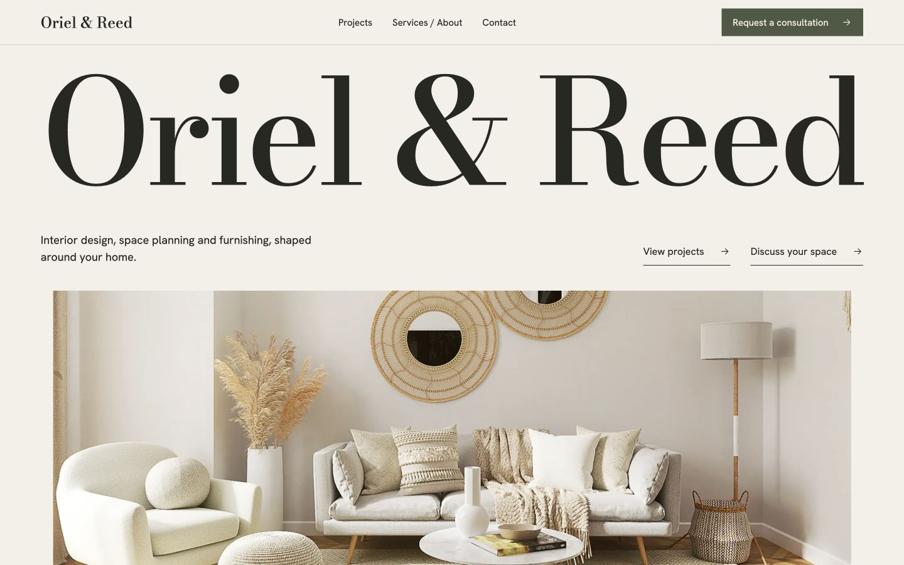

# Oriel & Reed

A frontend portfolio project for a fictional interior design studio, built with React, TypeScript, Vite and plain CSS. The visitor can explore three room concepts, filter them by room, open an accessible image viewer and try a clearly labelled consultation demo.

[Open the live portfolio](https://go.mosalah-77.workers.dev/oriel). The hosted form is a browser-only demo: nothing is sent or saved.



The studio, projects and proposals are fictional. The photographs are licensed references, with [credits and sources](docs/asset-credits.md). No clients, completed renovations or business results are claimed.

## Run locally

Use Node.js 22.12 or newer. If you use nvm, `nvm use` selects the version in `.nvmrc`.

```sh
npm ci
npm run dev
```

Open the address printed by Vite, normally **http://127.0.0.1:5173**. The server listens only on this computer. Saving a source file updates the preview.

| Command | Purpose |
| --- | --- |
| `npm test` | Run page, validation and real HTTP endpoint tests |
| `npm run build` | Check TypeScript and create `dist/` |
| `npm run preview` | Serve the production build locally, including the test endpoint |

The GitHub Actions workflow runs a clean dependency install, tests and a build on pushes to `main` and pull requests. Its permissions are read-only and its actions are pinned to commit IDs.

## What is included

- Four main pages: Home, Projects, Services/About and Contact; three concept pages share one detail layout.
- Local responsive WebP images and self-hosted fonts.
- A subtle CSS scroll-driven hero and 8px section entrances. Mobile, reduced-motion preferences and unsupported browsers receive static content.
- Room filters, a native image dialog and mobile menu, keyboard focus handling, a skip link and descriptive page titles.
- A contact form with shared browser/server validation, pending feedback, confirmed local saves, retry and failure states.

## The contact form is a demo

On the live site, the form is labelled **Portfolio demo** and asks for fictional details. It validates in the browser and displays **Demo complete**. It makes no submission request, stores no form data and books no consultation.

On a loopback address (`localhost`, `127.0.0.1` or `[::1]`), the form is labelled **Local demo**. Use fictional details here too. Requests are saved as private JSON receipts in `.local/consultations/` on the machine running the server. No email is sent and no appointment is booked. The directory is excluded from Git and blocked from Vite's file server.

The endpoint accepts bounded, same-origin loopback requests only. Stable request IDs and atomic writes prevent duplicate receipts on unchanged retries. The [contact walkthrough](docs/contact.md) explains the limits and failure checks.

The public site serves only `dist/`; it **does not include the endpoint**. The build creates an HTML entrypoint for every page and a 404 entrypoint. Routes accept trailing slashes. This version runs at the host root, not a GitHub Pages project subpath. See [deployment notes](docs/deployment.md) for the Sites configuration and publishing workflow.

## Verification

The [12-pass verification record](docs/verification-loop.md) documents the findings, fixes and evidence. The checked version passed:

- 24 automated tests and the TypeScript/production build.
- 16 axe scans across eight routes at desktop and phone widths, with no reported violations or incomplete checks.
- 96 viewport, enlarged-text and short-screen cases without horizontal overflow or obscured skip-link destinations.
- Keyboard menu/viewer checks, filters, missing-image feedback, hero fallbacks and form save/rejection/timeout flows.
- Production performance checks on seven routes, with no measured layout shift, long tasks or broken requests in those local runs.

These results describe the recorded checks, not full accessibility conformance or performance on every device. See the [finishing check](docs/finish.md) for changes and checks after that audit. Physical devices, screen-reader speech, Safari and Firefox still need testing. The contact form has no public delivery service.

The hosting update adds browser-demo and trailing-slash checks, bringing the automated suite to 26 tests. A browser fixture also confirms that completing the public demo makes zero submission attempts and moves focus to its completion heading.

## Where to look

| File | Responsibility |
| --- | --- |
| `src/App.tsx` | Routes, navigation, shared sections and project pages |
| `src/projects.ts` | The single source for concept copy, room labels and images |
| `src/ProjectImage.tsx`, `src/ImageViewer.tsx` | Responsive images and the modal viewer |
| `src/dialog-focus.ts` | Shared dialog keyboard handling |
| `src/Contact.tsx`, `src/contact-validation.ts` | Form state and shared field rules |
| `server/contact.ts` | Local request validation and private receipt storage |
| `src/styles.css` | Typography, layout, responsive rules and CSS motion |
| `tests/` | Automated checks and development-only browser fixtures |

The browser uses only React and React DOM as runtime dependencies. There is no router, animation or component library. Normal links navigate between routes. The browser fixtures are excluded from the production build.

## Authorship and learning

Mohamed chose the project, set the learning goals, approved the visual direction and completed six guided edits: hero spacing, title travel, a project summary, process spacing, the brief's minimum length and a room filter label. Codex generated the implementation, tests and documentation, and ran the recorded checks. This is an **AI-assisted learning project**, not a claim of unaided authorship.

The [learning log](docs/learning-log.md) separates those contributions. Short walkthroughs cover [motion](docs/hero-motion.md), [shared project data](docs/concept-projects.md), [services and process](docs/services-process.md), [the gallery](docs/project-gallery.md) and [the form](docs/contact.md).

Halvern and the credited award-winning sites informed the visual direction. Their source code, branding and client work are not included. Third-party images and fonts retain their respective licences; see [asset credits](docs/asset-credits.md).
